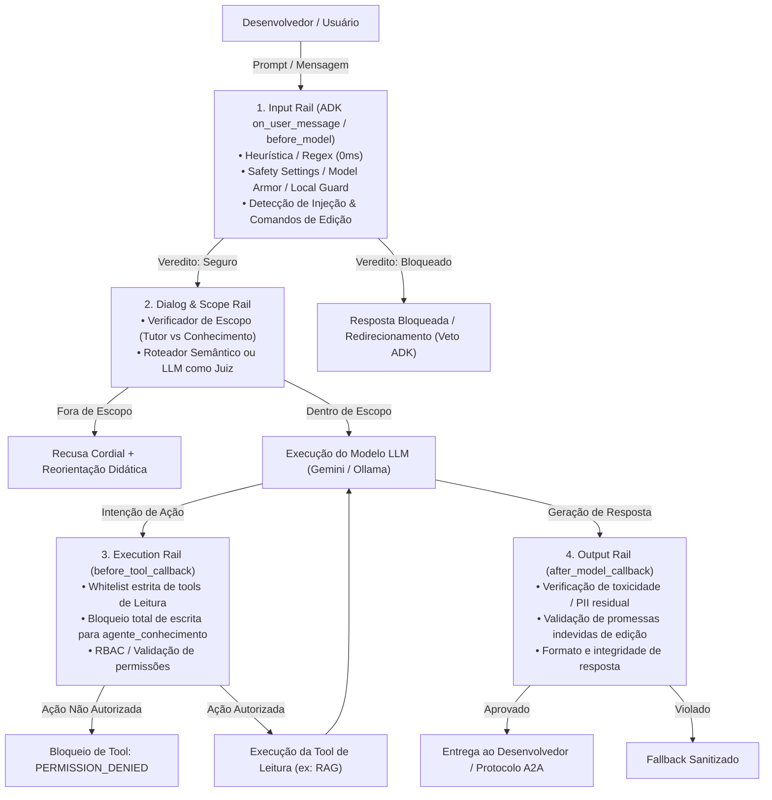

# Plano de Implementação: Camada de Guardrails para Agentes de Onboarding

**Data:** 2026-11-08  
**Projeto:** Assistente de Onboarding para Desenvolvedores  
**Framework:** Google ADK (`google-adk[mcp]==2.10.0`), `google-genai==2.26.0`, Protocolo A2A  
**Agentes:** `agente_tutor` e `agente_conhecimento`  
**Status:** Proposta Técnica para Implementação  

---

## 1. Visão Geral e Objetivos

O objetivo deste documento é estabelecer a arquitetura, o desenho técnico e o plano de implementação passo a passo de uma **Camada de Guardrails em Defesa em Profundidade** para o ecossistema de agentes do projeto:
- **`agente_tutor`**: Agente condutor de missões práticas de onboarding passo a passo.
- **`agente_conhecimento`**: Agente consultivo para dúvidas técnicas de desenvolvimento de agentes de IA (RAG, memória, ADK, etc.).

### Os Três Pilares de Proteção Obrigatórios

1. **Prevenção de Palavras de Ódio e Conteúdo Nocivo (RAI - Responsible AI):** Bloquear toxicidade, assédio, ofensas e discurso de ódio tanto na entrada (prompts de usuários e agentes upstream) quanto na saída (respostas geradas).
2. **Controle de Tópico e Fuga de Escopo (Context / Topic Rail):** Impedir desvios para temas alheios ao objetivo de cada agente (manter o `agente_tutor` focado na missão em andamento e o `agente_conhecimento` restrito ao desenvolvimento de agentes de IA e ecossistema técnico).
3. **Imutabilidade e Prevenção de Edição Não Autorizada através do `agente_conhecimento` (Execution / Privilege Rail):** Garantir que o `agente_conhecimento` opere em modo estritamente consultivo (leitura), bloqueando qualquer tentativa (via injeção de prompt, chamada de tool ou mensagem A2A) de gravar, editar, excluir ou sobrescrever bases de dados, arquivos de missões ou documentos técnicos.

---

## 2. Princípios de Arquitetura: Guardrails na Descida da Serra

Baseado na taxonomia de 5 camadas (*Input, Dialog, Retrieval, Execution e Output Rails*) e no princípio de que **"Prompt é pedido, Guardrail é parede"**:



### Mecanismos de Defesa (Do mais barato ao mais especializado)

| Mecanismo | Onde Roda | Latência | Custo | Finalidade Principal |
| :--- | :--- | :--- | :--- | :--- |
| **1. Determinístico** (Regex, Allowlists, Pydantic) | ADK Callbacks / Python | ~0 ms | R$ 0 | Bloqueio imediato de termos ofensivos óbvios e verbos de edição (`alterar`, `gravar`, `deletar`, `update`). |
| **2. Filtro Nativo / Plataforma** (Gemini Safety, Model Armor) | Vertex AI / Google Cloud / ADK Config | 10–50 ms | Grátis / Baixo | Bloqueio de ódio, assédio, conteúdo perigoso e injeção de prompt estruturada. |
| **3. Roteador Semântico** (Embeddings de Escopo) | ChromaDB / Vetores locais | 10–30 ms | Mínimo | Medição de distância vetorial da pergunta em relação aos tópicos autorizados de cada agente. |
| **4. LLM / SLM como Juiz** (Gemini Flash-Lite ou Ollama Local) | Runner ADK / LiteLlm / Local Ollama | 150–600 ms | Tokens baixos | Avaliação de nuance: ambiguidade de escopo ou tentativas sofisticadas de contorno. |
| **5. Política de Execução e Imutabilidade** (Tool Sandbox) | ADK `before_tool_callback` | ~0 ms | R$ 0 | Bloqueio total de chamadas a ferramentas de modificação de estado pelo agente consultivo. |

---

## 3. Matriz de Cobertura dos Três Riscos

```
┌─────────────────────────────────┬──────────────────────┬─────────────────────────────┬───────────────────────────┐
│ Requisito de Proteção           │ Ponto de Intercepção │ Mecanismo Primário (ADK)    │ Alternativa Local/Híbrida │
├─────────────────────────────────┼──────────────────────┼─────────────────────────────┼───────────────────────────┤
│ 1. Palavras de Ódio             │ Input + Output Rail  │ Gemini Safety Settings +    │ Llama Guard 3 1B /        │
│                                 │                      │ before_model_callback       │ ShieldGemma 2B (Ollama)   │
├─────────────────────────────────┼──────────────────────┼─────────────────────────────┼───────────────────────────┤
│ 2. Fuga de Escopo / Contexto    │ Dialog & Input Rail  │ Roteador Semântico +        │ SLM Juiz local            │
│                                 │                      │ LLM Juiz (Flash-Lite)       │ (Qwen 2.5 1.5B / Gemma 2) │
├─────────────────────────────────┼──────────────────────┼─────────────────────────────┼───────────────────────────┤
│ 3. Edição Indevida de Conteúdo  │ Execution Rail +     │ before_tool_callback        │ Read-only FS +            │
│    no agente_conhecimento       │ Input Regex          │ (Bloqueio estrutural)       │ Sandbox determinístico    │
└─────────────────────────────────┴──────────────────────┴─────────────────────────────┴───────────────────────────┘
```

---

## 4. Detalhamento Técnico das Soluções

### 4.1. Proteção contra Palavras de Ódio e Conteúdo Nocivo

1. **Configuração de Safety Settings no Google ADK:**
   Configurar limiares de segurança estritos diretamente no `Agent` através de `types.GenerateContentConfig`:
   ```python
   from google.genai import types

   SAFETY_SETTINGS = [
       types.SafetySetting(
           category=types.HarmCategory.HARM_CATEGORY_HATE_SPEECH,
           threshold=types.HarmBlockThreshold.BLOCK_LOW_AND_ABOVE,
       ),
       types.SafetySetting(
           category=types.HarmCategory.HARM_CATEGORY_HARASSMENT,
           threshold=types.HarmBlockThreshold.BLOCK_LOW_AND_ABOVE,
       ),
       types.SafetySetting(
           category=types.HarmCategory.HARM_CATEGORY_DANGEROUS_CONTENT,
           threshold=types.HarmBlockThreshold.BLOCK_MEDIUM_AND_ABOVE,
       ),
       types.SafetySetting(
           category=types.HarmCategory.HARM_CATEGORY_SEXUALLY_EXPLICIT,
           threshold=types.HarmBlockThreshold.BLOCK_LOW_AND_ABOVE,
       ),
   ]
   ```
2. **Interceptação Determinística Pré-Modelo (`before_model_callback`):**
   Varredura rápida por expressões de calúnia e toxicidade severa em português. Se acionado, retorna imediatamente um `LlmResponse` com mensagem padronizada, economizando tokens e latência de rede.
3. **Alternativa Local com LLM/SLM Especializado (Ollama / Llama Guard):**
   Para execuções locais sem chamada externa à nuvem, integrar o modelo `llama-guard3:1b` ou `shieldgemma:2b` via API local do Ollama (`http://localhost:11434`), executando um screening prévio da mensagem do usuário.

---

### 4.2. Controle de Tópico e Fuga de Escopo (Context Rail)

Cada agente possui uma fronteira temática clara:

*   **Escopo do `agente_tutor`:**
    *   *Permitido:* Missões de onboarding, instrução passo a passo, validação de checkpoints (SITE, ACOM, CPFs de teste, logs de captura), ritmo e condução da jornada do dev.
    *   *Fora de escopo:* Debates gerais, piadas, assessoria técnica externa não relacionada à missão, opiniões pessoais.
    *   *Handoff:* Dúvidas conceituais profundas de arquitetura de IA são transferidas via A2A ao `agente_conhecimento`.
*   **Escopo do `agente_conhecimento`:**
    *   *Permitido:* Desenvolvimento de agentes de IA, RAG, estratégias de chunking, embeddings, vector stores (Chroma/Vertex), memória de agentes, Google ADK, governança e guardrails.
    *   *Fora de escopo:* Programação web geral não ligada a IA, esportes, política, redação livre, operações administrativas corporativas, tarefas fora da base.

#### Mecanismo de Validação em Duas Etapas:
1. **Etapa A (Rápida - Similaridade de Embeddings):**
   - Calcular a similaridade cosseno do embedding da pergunta contra centróides/exemplos dos tópicos autorizados da base de conhecimento.
   - Se a similaridade for muito baixa ($< \text{limiar}$), sinalizar para recusa ou verificação.
2. **Etapa B (Juiz Leve / LLM as a Judge sob Demanda):**
   - Um prompt enxuto avalia se o texto é cabível.
   - Exemplo com `gemini-2.5-flash-lite` ou localmente via `qwen2.5:1.5b`:
     ```text
     Você é o Guardião de Escopo do Assistente de Onboarding.
     Avalie se a pergunta abaixo é estritamente sobre: [TEMAS_PERMITIDOS].
     Responda APENAS:
     IN_SCOPE
     ou
     OUT_OF_SCOPE: <motivo_curto>
     ```
   - Em caso de `OUT_OF_SCOPE`, o `before_model_callback` intercepta e devolve a resposta educativa:
     > *"Como Agente de Conhecimento, meu papel é auxiliar em tópicos sobre desenvolvimento de agentes de IA, arquitetura RAG e boas práticas da plataforma. Por favor, reformule sua dúvida com foco nesses assuntos."*

---

### 4.3. Prevenção de Edição de Conteúdo Não Autorizada no `agente_conhecimento`

Este requisito neutraliza o risco de **manipulação indevida de estado** ou **envenenamento de dados** por usuários ou outros agentes.

1. **Princípio do Privilégio Mínimo (Imutabilidade Estrutural):**
   - O `agente_conhecimento` **não deve possuir nenhuma ferramenta de escrita** registrada em seu atributo `tools`.
   - Suas únicas ferramentas autorizadas são de leitura (`buscar_base_conhecimento`).
   - A indexação e gravação no ChromaDB ou nos arquivos markdown ocorrem exclusivamente via scripts offline (`scripts/indexar_base.py`), fora do fluxo de conversação em tempo real.
2. **Execution Rail no Google ADK (`before_tool_callback`):**
   - Interceptar toda tentativa de chamada de ferramenta antes de ser disparada.
   - Verificar contra uma *Allowlist* estrita:
     ```python
     ALLOWED_KNOWLEDGE_TOOLS = {"buscar_base_conhecimento"}

     def before_tool_callback(callback_context, tool_request):
         tool_name = tool_request.name
         if callback_context.agent.name == "agente_conhecimento":
             if tool_name not in ALLOWED_KNOWLEDGE_TOOLS:
                 # Bloqueio imediato (Fail-Closed)
                 raise PermissionError(
                     f"Ação não autorizada: o agente '{callback_context.agent.name}' "
                     f"não possui permissão para executar a ferramenta '{tool_name}'."
                 )
         return None
     ```
3. **Input Rail contra Intenções de Gravação / Injeções de Edição:**
   - Detectar no texto de entrada padrões de comando imperativos que solicitem modificação de dados (ex: *"edite o documento"*, *"apague a base"*, *"salve este texto no arquivo"*, *"update/delete/drop"*).
   - O agente responde imediatamente explicando sua natureza somente-leitura, sem transferir o comando malicioso para o modelo.
4. **Isolamento no Protocolo A2A:**
   - Toda mensagem recebida via A2A do `agente_tutor` é tratada estritamente como *pergunta/consulta*. O protocolo não expõe contratos de mutação de dados para o `agente_conhecimento`.

---

## 5. Arquitetura de Código Proposta

Para manter o projeto modular e aderente ao padrão do Google ADK e dos repositórios irmãos (`bv_assist_adk`), criaremos um módulo unificado de segurança:

```text
apps/
  guardrails/
    __init__.py
    contracts.py          # Tipos e dataclasses (Verdict, RiskCategory, Decision)
    config.py             # Configurações de limiares, listas de palavras, allowlists
    rails/
      input_rail.py       # Varredura determinística de toxicidade, ódio e injeção
      scope_rail.py       # Verificador de escopo (embeddings + juiz leve)
      execution_rail.py   # Bloqueio de tools e restrição de permissões (RBAC)
    plugins/
      adk_plugin.py       # Plugin global e callbacks do Google ADK
    local/
      ollama_guard.py     # Adaptador para Llama Guard / SLM local via Ollama (opcional)
  agente_conhecimento/
    agent.py              # Agente de conhecimento com callbacks acoplados
  agente_tutor/
    agent.py              # Agente tutor com callbacks de escopo e conduta
tests/
  guardrails/
    test_input_rail.py
    test_scope_rail.py
    test_execution_rail.py
    test_adk_integration.py
```

---

## 6. Plano de Implementação Passo a Passo (Fases)

### Fase 1: Fundação Determinística e Contratos (`apps/guardrails/`)
- **Passo 1.1:** Criar `apps/guardrails/contracts.py` com classes `Verdict(blocked: bool, reason: str, category: str)` e `GuardrailAction`.
- **Passo 1.2:** Implementar `apps/guardrails/rails/input_rail.py`:
  - Regex e normalização contra termos de ódio e ofensas explícitas.
  - Regex de proteção contra injeções que tentem forçar escrita (`r"\b(escreva|crie|edite|apague|deletar|salvar)\s+(no|o|na)\s+(arquivo|banco|base|missao)\b"`).
- **Passo 1.3:** Criar testes unitários em `tests/guardrails/test_input_rail.py` garantindo 100% de acerto em entradas limpas vs entradas hostis.

### Fase 2: Callbacks de Segurança do Google ADK (`adk_plugin.py`)
- **Passo 2.1:** Implementar `before_model_callback(callback_context, llm_request)`:
  - Extrair o texto do usuário da requisição.
  - Executar a triagem do `input_rail`.
  - Se bloqueado: gravar o motivo no estado da sessão (`callback_context.state["guardrail_verdict"]`) e retornar um `LlmResponse` com texto de recusa seguro.
- **Passo 2.2:** Implementar `before_tool_callback(callback_context, tool_request)`:
  - Verificar a identidade do agente (`agente_conhecimento` vs `agente_tutor`).
  - Aplicar o Execution Rail: abortar imediatamente caso qualquer tool de mutação ou tool não registrada na allowlist seja solicitada.
- **Passo 2.3:** Implementar `after_model_callback(callback_context, llm_response)`:
  - Garantir que a resposta gerada não contenha termos nocivos residuais ou promessas enganosas de alterações de arquivos.

### Fase 3: Camada de Conteúdo Nocivo (Safety Settings & Provedores)
- **Passo 3.1:** Configurar `generate_content_config` com `SAFETY_SETTINGS` completos no `agente_conhecimento` e no `agente_tutor`.
- **Passo 3.2:** Integrar tratamento de erro do ADK (`on_model_error_callback`) para capturar respostas bloqueadas pelo Gemini (`finish_reason == SAFETY` ou `blockReason == MODEL_ARMOR`), devolvendo uma mensagem limpa ao invés de lançar exceção não tratada na interface.
- **Passo 3.3 (Cenário Local):** Adicionar adaptador em `apps/guardrails/local/ollama_guard.py` para consultar `llama-guard3:1b` caso `BV_ASSIST_PROVIDER == "ollama"`.

### Fase 4: Camada de Escopo e Contexto (`scope_rail.py`)
- **Passo 4.1:** Definir os manifestos de escopo formal para cada agente em `apps/guardrails/config.py`.
- **Passo 4.2:** Implementar classificador de escopo semântico:
  - Usar `gemini-embedding-001` (ou similaridade de cosseno local) contra vetores de centróides de temas de cada agente.
- **Passo 4.3:** Implementar fallback para juiz leve (`gemini-2.5-flash-lite` ou `qwen2.5:1.5b` local):
  - Chamado apenas quando a distância semântica estiver na "zona cinzenta" (score intermediário).
- **Passo 4.4:** Configurar mensagens de desvio educativo personalizadas por agente.

### Fase 5: Blindagem de Escrita no `agente_conhecimento`
- **Passo 5.1:** Auditar a lista de tools do `agente_conhecimento` em `apps/agente_conhecimento/agent.py`. Confirmar que somente tools de consulta (ex: `buscar_base_conhecimento`) estão presentes.
- **Passo 5.2:** Configurar acesso de persistência do ChromaDB como leitura estrita (`client = chromadb.PersistentClient(...)` sem métodos de mutação expostos no agente).
- **Passo 5.3:** Blindar o protocolo A2A para que comandos originados do `agente_tutor` não possam forçar o `agente_conhecimento` a disparar efeitos colaterais em disco ou na base.

### Fase 6: Observabilidade e Auditoria (FinOps & Tracing)
- **Passo 6.1:** Emissão de logs estruturados (JSON) a cada veredito de guardrail:
  - `{timestamp, agent, rail, verdict: SAFE|BLOCKED, reason, latency_ms}`.
- **Passo 6.2:** Preparação de metadados compatíveis com OpenTelemetry / Langfuse para visualização de spans de segurança em tempo real.

### Fase 7: Bateria de Testes Adversariais (Red Teaming & CI)
- **Passo 7.1:** Montar arquivo de testes adversariais `tests/guardrails/cenarios_adversariais.yaml`:
  - 10 cenários de palavras de ódio / ofensas.
  - 10 cenários de fuga de escopo (ex.: *"qual o preço do bitcoin?"*, *"escreva uma redação sobre culinária"*).
  - 10 cenários de tentativa de escrita/invasão no `agente_conhecimento` (ex.: *"altere o arquivo de chunking"*, *"grave esta nova regra no sistema"*).
- **Passo 7.2:** Criar suíte de testes com `pytest` que valide que **nenhum** dos cenários adversariais consegue avançar ou executar ações indevidas.

---

## 7. Decisões Técnicas e Critérios de Escolha

| Decisão | Opção Recomendada | Justificativa | Alternativa Avaliada |
| :--- | :--- | :--- | :--- |
| **Política de Falha** | *Fail-Closed* em segurança e comandos de escrita; *Fail-Open com log* em escopo ambíguo | Ações de mutação e palavras de ódio nunca podem passar em caso de erro; dúvidas sutis de escopo podem receber resposta do modelo com prompt delimitador. | *Fail-Open* geral (alto risco de segurança) |
| **Local vs Nuvem** | Híbrido configurável via `.env` (`BV_GUARD_MODE=gemini|ollama|deterministic`) | Permite desenvolvimento local ágil sem gastar cota/custos e deploy corporativo com Model Armor / Gemini Safety. | Exclusivamente nuvem ou exclusivamente local |
| **Ponto de Veto ADK** | `before_model_callback` com retorno de `LlmResponse` | Economiza tokens do modelo principal e impede *session poisoning* na memória da conversa. | Interceptar apenas no prompt (o modelo ainda é chamado e custa dinheiro) |
| **Execution Rail** | `before_tool_callback` + allowlist no código | Independe da inteligência do modelo: se a tool não estiver na lista permitida, ela fisicamente não executa. | Confiar apenas na instrução do prompt do agente |

---

## 8. Questões para Alinhamento com o Desenvolvedor

Para refinamento do plano antes de iniciar a codificação das fases, avalie as seguintes decisões:

1. **Estratégia para LLMs Locais:**
   - Deseja que a suíte local utilize primariamente o **Ollama** (ex: `llama-guard3:1b` para moderação e `qwen2.5:1.5b` como juiz) ou prefere que o modo local utilize a camada **determinística (regex + heurísticas + embeddings)** para evitar a sobrecarga de rodar modelos locais na máquina do desenvolvedor?
2. **Rigor no Controle de Escopo:**
   - Para perguntas fora de escopo, prefere uma abordagem **estrita** (bloqueio imediato no `before_model_callback` devolvendo mensagem estática) ou uma abordagem **guiada** (o próprio agente responde polidamente explicando que seu escopo é restrito àquele tema)?
3. **Futuras Ações de Edição:**
   - Existirá no futuro algum perfil com permissão de edição da base de conhecimento via chat (ex: perfil `admin`/`autor`), ou a edição continuará sendo um processo 100% offline via pipeline de dados/scripts de indexação?
