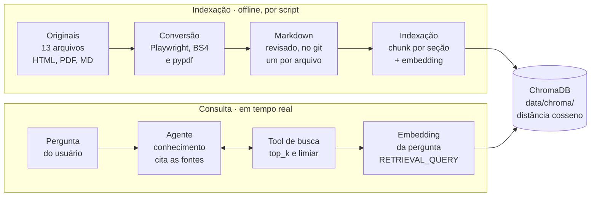

# Plano — RAG da base de conhecimento com ChromaDB

Data: 2026-11-06

## Objetivo e escopo

Construir um RAG com ChromaDB sobre os 13 arquivos de `resources/base-conhecimento/` e expô-lo como tool do `agente_conhecimento`, que hoje é um placeholder com prompt de respostas inventadas.

Critério geral de decisão: **menor esforço**. Só entra o que é necessário para o RAG funcionar e ser avaliado.

- **Dentro do escopo:** extração e normalização da base, chunking, embeddings, índice Chroma persistente, tool de busca, novo prompt do agente e avaliação de recuperação.
- **Fora do escopo:** tudo o que não é construção do RAG. Isso inclui a integração com o `agente_tutor` (forma de chamada, A2A), testes de fluxo de missões, a `description` do agente (fica como está) e qualquer preparo para fontes futuras. O MVP cobre só a trilha de IA, e a forma como o agente é exposto hoje não muda.

## Diagnóstico da base

Metade dos HTMLs guarda o conteúdo dentro de objetos JavaScript. Um parser comum extrai só de 137 a 747 caracteres desses arquivos, então eles exigem um extrator próprio.

| Tipo | Arquivos | Texto visível a um parser comum | Extração |
| --- | --- | --- | --- |
| HTML com conteúdo em JS | `rag__agentic-retrieval-e-memoria`, `rag__masterclass-rag-e-memoria`, `rag__rag-avancado-e-agentes`, `memoria-agentes__the-memory-arquitetura-stateful`, `fundamentos-agentes__ecossistema-adk-e-economia-de-tokens` | 137 a 747 caracteres (scripts de 46 KB a 656 KB) | Playwright headless, lendo as variáveis de dados (`MODULES` e equivalentes) com `page.evaluate` |
| HTML estático | `embeddings__embeddings-do-zero`, `vector-stores__indices-ann-e-vector-stores`, `vector-stores__anatomia-vertex-ai-vector-search`, `busca-hibrida__bm25-e-rrf`, `programa__jornada-agentes-ia-visao-geral` | 2,6 mil a 14,7 mil caracteres | BeautifulSoup, sem nav, sidebar e footer |
| PDF | `guardrails__deck-guardrails-descida-da-serra` (29 pág.), `rag__deck-rag-na-agent-platform` (34 pág.) | cerca de 29 mil caracteres cada | `pypdf`, um bloco por slide, corrigindo títulos com letras espaçadas ("A B E R T U R A") |
| Markdown | `rag__estrategias-de-chunking` | 8 KB | Leitura direta |

O prefixo antes de `__` no nome de cada arquivo já indica o tema e vira metadado.

## Arquitetura

A indexação roda offline por script, e em tempo real o agente só consulta o índice por meio da tool.



O Chroma devolve até 5 trechos acima do limiar, com fonte e seção, para a tool repassar ao agente.

```text
resources/base-conhecimento/        originais (inalterados, mantidos como material didático)
resources/base-conhecimento-md/     markdown revisado (Fase 1)
data/chroma/                        índice persistente (no .gitignore)

apps/agente_conhecimento/
  agent.py                          prompt novo + tool
  rag/
    config.py                       caminhos, coleção, modelo, tamanhos, top_k, limiar
    chunking.py                     corte por heading + metadados
    embeddings.py                   cliente de embedding Gemini
    indice.py                       delete por fonte, add, query
    busca.py                        buscar_base_conhecimento()
scripts/
  converter_base.py                 originais → markdown (mantido no repo como material didático)
  indexar_base.py                   markdown → Chroma
  avaliar_rag.py                    hit@3 com perguntas de teste
tests/
  test_chunking.py
```

## Fase 1: conversão para markdown revisado

Os 13 arquivos viram markdown em `resources/base-conhecimento-md/`, com o resultado versionado no git e revisado antes da indexação. Os originais e o conversor continuam no repositório para ilustrar por que os dados precisam ser preparados antes da ingestão.

1. Criar `scripts/converter_base.py` com um conversor por tipo (HTML estático, HTML com JS, PDF, MD).
2. Para cada HTML com JS, mapear a variável que guarda o conteúdo, lê-la com `page.evaluate` no Playwright e transformá-la em markdown com headings (módulo, bloco, capítulo).
3. Normalizar todos os arquivos: um H1 por arquivo, headings coerentes, sem texto de navegação, sem HTML residual.
4. Rodar a conversão e revisar cada `.md` lado a lado com o original.

O conversor sobrescreve os `.md` sem proteção. Se for rodado de novo por engano, o `git diff` mostra e recupera as correções manuais.

**Revisão:** leitura do autor, sem checklist formal. Verifica que nenhum arquivo está vazio, só com menus ou com HTML residual.

**Pronto quando:** os 13 `.md` existem e passaram pela revisão.

Motivo da etapa intermediária: a base é pequena, então revisar uma vez é mais barato que acertar tudo na extração automática, e o restante do pipeline lida com um formato só.

## Fase 2: chunking e indexação no Chroma

`scripts/indexar_base.py` lê o markdown, corta por seção e grava no Chroma. Pode ser rodado de novo sem duplicar nada.

- **Chunking:** hierárquico por heading, até 3.200 caracteres por trecho (cerca de 800 tokens, a ~4 caracteres por token, sem tokenizador), sem tamanho mínimo para não juntar seções distintas. É a estratégia nº 3 do próprio `rag__estrategias-de-chunking.md`. Seções maiores são subdivididas por parágrafo, **sem overlap** (justificativa e critério de revisão em [`estrategia-de-chunking.md`](estrategia-de-chunking.md)).
- **Cabeçalho contextual:** o texto de cada trecho começa com `"{titulo} > {secao}"`, e esse é o texto embedado e guardado no Chroma.
- **Embedding:** `gemini-embedding-001` via `google-genai`, dimensão padrão (3072), com `task_type=RETRIEVAL_DOCUMENT` na indexação e `RETRIEVAL_QUERY` na busca. Usa a mesma credencial que o ADK já usa (`GOOGLE_API_KEY` ou Vertex), sem configuração nova.
- **Chroma:** `PersistentClient` em `data/chroma/` (no `.gitignore`), coleção `base_conhecimento`, distância de cosseno.

| Metadado | Exemplo | Uso |
| --- | --- | --- |
| `fonte` | `rag__estrategias-de-chunking.md` | Citação, remoção por arquivo e avaliação |
| `tema` | `rag` | Informativo (não é filtro da tool no MVP) |
| `titulo` | Estratégias de chunking para RAG multi-formato | Citação |
| `secao` | `RAG > Chunking > Pai-filho` | Contexto do trecho e citação |
| `indice_chunk` | `4` | Ordem dentro do arquivo |

**Idempotência:** para cada arquivo, o script apaga todos os trechos com `where={"fonte": ...}` e insere de novo, com ID `"{fonte}::{indice_chunk}"`. Não se usa `hash()` do Python, que muda a cada processo. Trechos de arquivos removidos da pasta também são apagados pela `fonte`. Ao final, o script imprime a contagem de trechos.

**Pronto quando:** a coleção tem trechos dos 13 arquivos e rodar o script duas vezes imprime a mesma contagem.

## Fase 3: tool de busca e novo prompt

O `agente_conhecimento` ganha uma tool de busca e passa a responder só com base no que ela devolve.

```python
def buscar_base_conhecimento(pergunta: str) -> list[dict] | str:
    """Busca trechos relevantes na base de conhecimento.
    Retorna: [{texto, fonte, secao, score}], até top_k itens acima do limiar.
    score = 1 - distância de cosseno do Chroma."""
```

- `top_k` (padrão 5) e o limiar mínimo de similaridade ficam em `rag/config.py` e são calibrados na Fase 4.
- Sem trechos acima do limiar, a tool devolve lista vazia.
- O cliente do Chroma é aberto uma vez (lazy) e reaproveitado entre chamadas.
- Se o índice não existir, a tool devolve uma mensagem de erro em texto (sem lançar exceção) pedindo para rodar `indexar_base.py`.

**Regras do novo prompt:**

1. Sempre chama a tool antes de responder.
2. Responde só com base nos trechos devolvidos.
3. Cita `fonte` e `secao` de cada afirmação relevante.
4. Com lista vazia, diz que não encontrou na base e não completa com conhecimento próprio.
5. Respostas concisas, em português.

O prompt atual, que manda inventar respostas e falar de dinossauro, é removido.

**Pronto quando:** no `adk web`, uma pergunta coberta pela base volta com citação correta, e uma fora da base volta com "não encontrei".

## Fase 4: avaliação

Um conjunto de 16 perguntas com o arquivo esperado mede a recuperação (hit@3) e serve de régua para calibrar o tamanho dos chunks e o limiar.

1. Escrever `tests/avaliacao/perguntas.yaml` com uma pergunta por arquivo da base, mais 3 perguntas fora da base **próximas do domínio** (assuntos de IA que a base não cobre, por exemplo "como configurar o checkpointer do LangGraph?").
2. `scripts/avaliar_rag.py` roda cada pergunta pela tool e mede hit@3: o arquivo esperado aparece entre os 3 primeiros resultados?
3. Nas perguntas fora da base, verifica se nenhum resultado passa do limiar.
4. Ajustar o tamanho dos chunks e o limiar com base no resultado e registrar os valores escolhidos em `rag/config.py`.

Um único teste `pytest` (`tests/test_chunking.py`) cobre o chunking: corte por heading e metadados. A idempotência é verificada pela contagem impressa pelo script de indexação.

**Pronto quando:** hit@3 ≥ 85% nas perguntas da base e nenhum falso positivo nas perguntas fora dela. A meta é uma proposta inicial e pode ser revista após a primeira rodada.

## Decisões, dependências e evoluções

| Decisão | Escolha | Alternativa descartada |
| --- | --- | --- |
| Critério geral | Menor esforço | — |
| Modelo de embedding | `gemini-embedding-001`, 3072 dimensões (multilíngue, mesmo SDK e credencial do projeto) | `all-MiniLM-L6-v2` (padrão do Chroma, fraco em português), `multilingual-e5` local, dimensão reduzida (exige normalizar) |
| Pré-processamento | Markdown intermediário, versionado e revisado; conversor e originais mantidos como material didático | Extrair direto na indexação, sem revisão |
| Extração dos HTMLs com JS | Playwright com `page.evaluate` | Regex + JSON (frágil se o literal JS não for JSON válido) |
| Proteção contra reconversão | Nenhuma; o git recupera | Flag `--forcar` |
| Chunking | Hierárquico por heading, medido em caracteres, sem overlap, com cabeçalho contextual | Tamanho fixo; contagem por tokenizador; overlap de 10% |
| IDs | `"{fonte}::{indice_chunk}"` com delete por fonte + add | `hash()` do Python (muda a cada processo) |
| Filtro por tema | Fora da tool no MVP | Parâmetro `tema` (LLM pode filtrar errado) |
| Busca | Somente densa (vetorial) no MVP | Híbrida desde o início |
| Métrica | hit@3 por arquivo | hit@5 (fácil demais com 13 arquivos), MRR |
| Índice | Fora do git; passo de indexação documentado no README | Versionar `data/chroma/` |

**Dependências novas no `requirements.txt`** (arquivo único): `chromadb`, `beautifulsoup4`, `pypdf`, `playwright` (requer `playwright install chromium`, só para a conversão) e `pytest`.

**README:** acrescentar os passos `python scripts/indexar_base.py` antes do `adk web`.

**Evoluções depois do MVP**, só se a Fase 4 mostrar recall baixo: busca híbrida (BM25 + RRF), reranking e chunks pai-filho.
